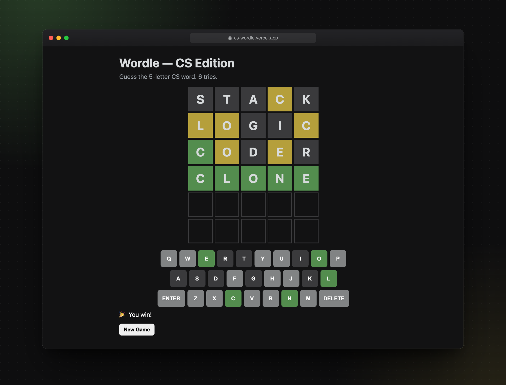

<div align="center">

# Wordle — CS Edition

A Wordle clone with computer science vocabulary.<br>
Plain HTML, CSS and JavaScript.

**[Play at cs-wordle.vercel.app](https://cs-wordle.vercel.app)**

<br>



</div>

## How to play

Guess the five-letter word in six tries. After each guess the tiles change colour:

🟩&nbsp; right letter, right spot<br>
🟨&nbsp; in the word, wrong spot<br>
⬛&nbsp; not in the word

Type on your keyboard or use the on-screen keys. **New Game**, or Enter after a round ends, picks a new word.

## Run locally

There's nothing to install. Open `index.html` in a browser, or serve the folder:

```bash
python3 -m http.server 8000
```

## Change the words

Answers come from the `WORDS` array in [`script.js`](script.js). Entries that aren't exactly five letters are skipped, so you can paste in a longer vocabulary list as is.
